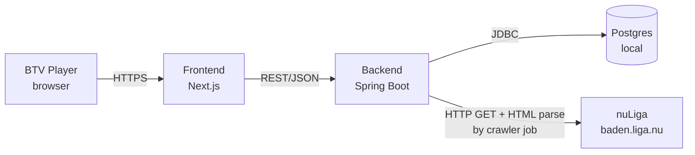
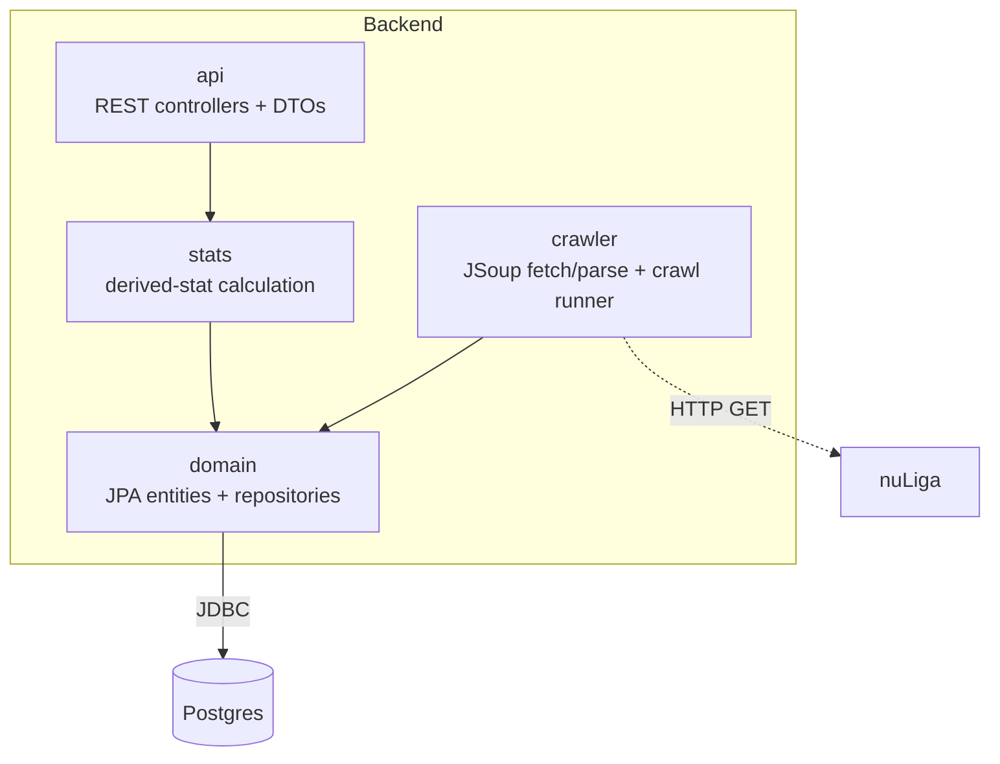

# 5. Building Block View

## Level 1: Whitebox Overall System

| Building Block | Responsibility |
|---|---|
| **Frontend** | Renders the search, player-stats and head-to-head UI; calls the backend's REST API from the Next.js server (Server Components and Server Actions), never from the browser. No direct DB or nuLiga access. |
| **Backend** | Single Spring Boot codebase and image with two entry points: the REST API, and a crawler mode that runs one crawl and exits (started locally as a separate process, see [07_deployment_view](../07_deployment_view/deployment_view.md)). Owns all reads/writes to Postgres. |
| **Postgres** | Stores players, teams, matches, sets — the only persistent store. |
| **nuLiga** | External system, read-only. Backend fetches and parses its public HTML pages; never writes to it. |

## Level 2: Backend (Spring Boot)

| Package | Responsibility |
|---|---|
| `api` | REST controllers and request/response DTOs — the only package the frontend's contract touches. Exposes an OpenAPI spec so the frontend can generate a typed client (needed since Java and TS don't share types — see [ADR-0001](../09_architecture_decisions/adr-0001-technology-stack.md)). |
| `stats` | Turns raw match/set rows into the derived numbers the vision calls for (win/loss, tie-break rate, streaks, deciding-set record, head-to-head). Kept separate from `api` so stat logic is testable without HTTP. |
| `domain` | JPA entities (`Player`, `Team`, `Match`, `Set`, ...) and Spring Data repositories. The one place that knows the DB schema. |
| `crawler` | JSoup-based fetch + parse of nuLiga's group/meeting pages, started by a one-shot runner in crawler mode (started locally, see [ADR-0002](../09_architecture_decisions/adr-0002-crawler-execution.md) and [ADR-0003](../09_architecture_decisions/adr-0003-local-only.md)), writing through `domain`'s repositories. The only package that talks to nuLiga. |

## Level 2: Frontend (Next.js)

| Directory | Responsibility |
|---|---|
| `app/` (routes) | Pages: player search, player stats page, a player's full match list, head-to-head — per the journeys in [user-journeys.md](../01_introduction_and_goals/user-journeys.md). |
| `components/` | UI building blocks (search box, stat cards, empty/loading states) using Tailwind + shadcn/ui, styled per the [UI concept](../08_crosscutting_concepts/ui_concept.md). |
| `lib/api-client` | Typed client (`openapi-fetch` over types generated from the backend's OpenAPI spec) — the frontend's only path to data, no direct DB access. Server-only; the backend URL comes from `TENNIS_STATS_API_BASE_URL`. |

## Interfaces

| Interface | Between | Shape |
|---|---|---|
| REST/JSON API | Frontend ↔ Backend | OpenAPI-described; typed client generated on the frontend from it. |
| HTML scraping | Backend (`crawler`) ↔ nuLiga | Read-only HTTP GET against the stable URLs identified in [03_system_scope_and_context](../03_system_scope_and_context/system_scope_and_context.md). |
| JDBC | Backend (`domain`) ↔ Postgres | Spring Data JPA/Hibernate. |
