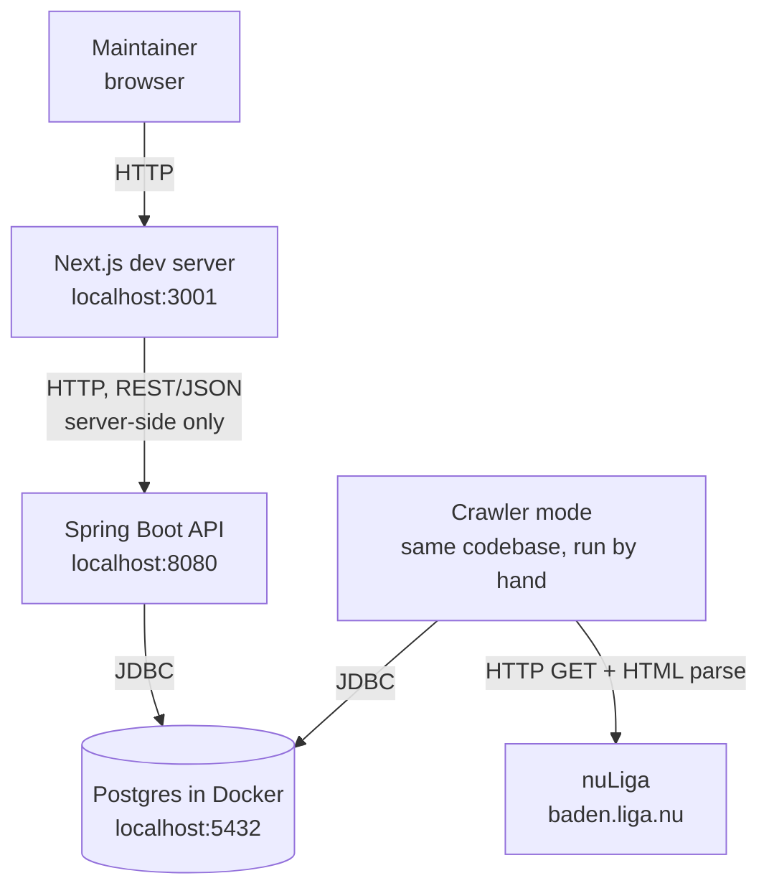

# 7. Deployment View

Tennis Stats runs locally for personal use only, per
[ADR-0003](../09_architecture_decisions/adr-0003-local-only.md). Nothing is
deployed.

## Infrastructure Level 1

| Building block | Runs on | Lifecycle |
|---|---|---|
| Frontend | Local Next.js dev server | Started when needed (`npm run dev`). |
| Backend API | Local JVM (`gradlew bootRun`) | Started when needed. |
| Crawler | Local JVM, `crawler` Spring profile | Started by hand (or a local schedule), runs one crawl, exits. |
| Database | Postgres container (`backend/postgres/start.sh`) | Data stays on the local machine. |

## Notes

- The browser only talks to the Next.js frontend. Pages are Server
  Components that call the backend API from the Next.js server, and the
  compare picker's opponent search runs as a Server Action there too. The
  backend URL is a server-only setting and never reaches the browser, so the
  backend needs no CORS configuration.
- The crawler is not part of the API process. The API runs no scheduler.
- Crawled data never leaves the machine: no published dumps, and database
  files stay out of git.

## Configuration

Names only; values are never committed.

| Setting | Used by | Purpose |
|---|---|---|
| `DB_URL`, `DB_USERNAME`, `DB_PASSWORD` | API, crawler mode | Postgres connection; defaults match `backend/postgres/start.sh`. |
| `tennisstats.crawler.enabled` | crawler mode | Switches the crawler off, e.g. for local development. |
| `tennisstats.crawler.request-delay` | crawler mode | Politeness delay before every request (default 2s). |
| `TENNIS_STATS_API_BASE_URL` | Frontend (Next.js server) | Backend API base URL including `/api/v1`. Server-only, not a `NEXT_PUBLIC_` variable; defaults to `http://localhost:8080/api/v1`. |
